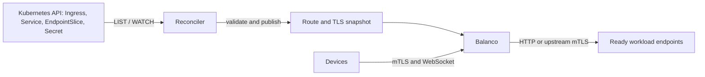

# Kubernetes Ingress controller

Ingress mode is built into `balanco`; there is no sidecar, shell or Kubernetes
client-library runtime dependency. Each replica watches `networking.k8s.io/v1`
Ingresses, Services, `discovery.k8s.io/v1` EndpointSlices and Secrets in **one
configured namespace**. It builds an atomic route/TLS snapshot outside the traffic
path. Requests never call the Kubernetes API.



This feature requires a build containing the Ingress implementation on `main`;
the v0.1.1 release predates it. Build your image from this checkout or use a
verified newer main image, then pin its digest in the deployment.

## Deploy

The [Ingress bundle](kubernetes-ingress/) extends the existing gateway deployment
with an IngressClass, ServiceAccount and namespace-scoped read-only Role. It runs
two replicas, each limited to two CPUs, behind the existing LoadBalancer Service.
On k3s, disable bundled Traefik as in the [k3s recipe](k3s.md).

The default namespace is `balanco-ingress`. Workloads, their Services, Ingresses
and referenced TLS Secrets must be in that namespace. To change it, update both
the Kustomize namespace and `ingress.namespace` in `balanco.json`. Changing only
one leaves the controller without the intended cache/RBAC scope. The
`ingress.class` value must match the installed IngressClass name.

```sh
kubectl create namespace balanco-ingress
kubectl -n balanco-ingress create secret generic balanco-tls \
  --from-file=tls.crt=/secure/fallback-fullchain.pem \
  --from-file=tls.key=/secure/fallback.key \
  --from-file=client-ca.crt=/secure/device-ca.pem
kubectl -n balanco-ingress create secret tls devices-tls \
  --cert=/secure/devices-fullchain.pem --key=/secure/devices.key
kubectl apply -k deploy/kubernetes-ingress
kubectl -n balanco-ingress rollout status deployment/balanco
```

Supply a workload Service named `workload` with a TCP port named `web`, and a
server certificate covering `devices.example.test`, before applying
[the example Ingress](../examples/ingress.yaml):

```sh
kubectl apply -f examples/ingress.yaml
kubectl -n balanco-ingress get ingress,service,endpointslice
kubectl -n balanco-ingress logs -l app=balanco --prefix --tail=30
```

The fallback identity and device CA are separate from Ingress server identities.
The bundle requires device mTLS for every host. Remove `tls.client_ca` from its
configuration if you deliberately want ordinary HTTPS. Restrict namespace
administration: the controller's ServiceAccount can read **all Secrets in that
namespace**, but has no cluster-wide Secret access or write permissions. It
verifies the Kubernetes API certificate and rereads the projected bearer token
on watch reconnection.

## Routing and updates

- Only Ingresses with an explicit matching `spec.ingressClassName` are claimed.
  Exact hosts, one-label wildcard hosts and hostless rules are supported. More
  specific hosts win; within a host the longest path wins, with `Exact` winning
  equal-length ties. `Prefix` respects path-element boundaries;
  `ImplementationSpecific` uses the same semantics as `Prefix`.
- Service backends support named or numeric ports. Ready, non-terminating IPv4
  and IPv6 EndpointSlice addresses are selected directly with round-robin.
  Selectorless Services can use operator-managed EndpointSlices. Owned slices
  from an older Service UID are excluded after Service recreation. ExternalName
  and custom-resource backends are unsupported.
- An Ingress `defaultBackend` handles otherwise unmatched requests. Conflicting
  rules/defaults are resolved by oldest creation timestamp, then resource name.
  No matching route returns 404; missing Services/ports or no eligible endpoints
  return 503. These responses do not fall through to an unrelated workload.
- Every HTTP/1.1 request rechecks the current route and endpoint eligibility,
  including requests on an existing frontend keep-alive connection. A ready
  upstream connection is reusable. WebSocket Upgrade uses the same host/path
  selection and header rules; established WebSockets keep their backend lease.
- Referenced `kubernetes.io/tls` Secrets provide SNI identities using `tls.hosts`
  and `tls.secretName`. Complete certificate/key updates replace identities for
  **new handshakes**, without restarting pods or interrupting existing sessions.
  A missing, malformed, mismatched or hostname-incompatible identity denies its
  affected SNI names. Unreferenced Secrets do not become server identities.

For backend mTLS, configure the shared `upstream_tls` trust/client identity as in
[the mTLS example](../examples/mtls.json), and annotate each backend Service:

```yaml
metadata:
  annotations:
    balanco.io/backend-server-name: workload.example.internal
```

That name must match the workload certificate. Upstream TLS is a listener-wide
policy: mixing plaintext and TLS Services on this listener is unsupported.
The default bundle uses plaintext HTTP toward workloads. Header transformations
remain available through `http1` rules and the existing authenticated management
controls, independently on each pod.

## Failure behavior and operations

Initial readiness waits for all four resource caches to synchronize. LISTs are
paginated; WATCHes resume from each resource's own resourceVersion. A 410 causes
a fresh LIST; connection, authorization and API failures retry with bounded
backoff while the last applied snapshot continues serving. Pending updates apply
when watches recover. This deliberately favors availability during an API outage;
a deletion cannot take effect until it is observed.

Updates are coalesced for 100 ms and validated on a blocking worker, then routes
and certificates publish together. Each resource cache is bounded to 4,096
objects/8 MiB; routing is bounded to 256 rules and 256 endpoints per Service.
Budget violations are logged, not silently accepted as a complete configuration.
The API is not consulted for client requests. Independent replicas converge
separately; publication is not a fleet-wide transaction.

Ingress, Service, EndpointSlice and referenced server-Secret changes require no
rollout. Base listener/admission settings, device CA, upstream credentials and
Ingress scope/class changes require a deployment update. SIGHUP is rejected in
Ingress mode so it cannot overwrite controller-owned state. Keep `backends`
empty; static hash/decision constraints and Jev weight publications do not manage
Ingress endpoint pools. The ordinary TCP/static gateway mode is unchanged.

The controller is read-only: it does not write `Ingress.status`, emit Kubernetes
Events, claim classless Ingresses or implement Gateway API resources. Inspect the
LoadBalancer Service for its external address; a blank Ingress ADDRESS does not
mean reconciliation failed. This is a TLS/HTTP/1.1 controller, without an HTTP
port-80 redirect listener, HTTP/2, regex rewrites or nginx-specific annotations.

Validate with your actual device clients: keep WebSockets exchanging messages
while changing a route, scaling a workload, replacing a TLS Secret and temporarily
interrupting API access. Check new requests select only ready endpoints, new
handshakes see the renewed certificate, existing streams survive, and pod UIDs
and restart counts remain unchanged. Pod/node failures still close their TCP
sessions; clients need backoff and jitter. This implementation is not a full
Ingress conformance or production-capacity qualification.
