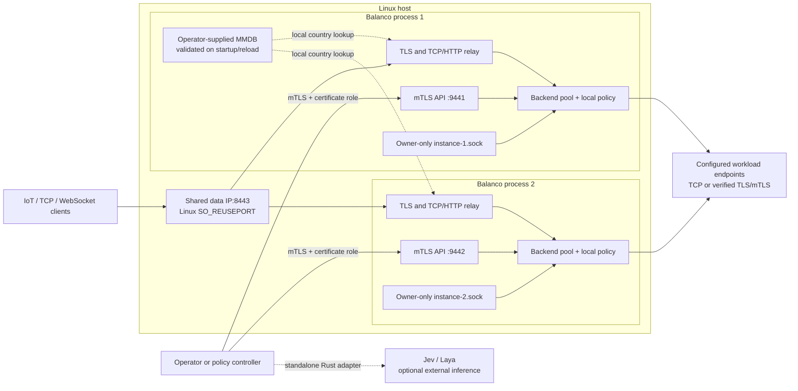
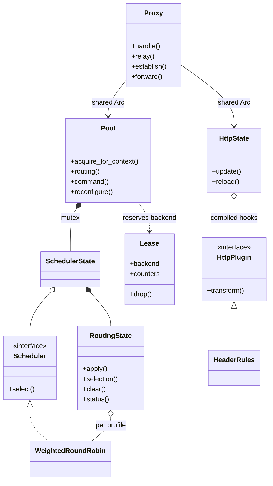
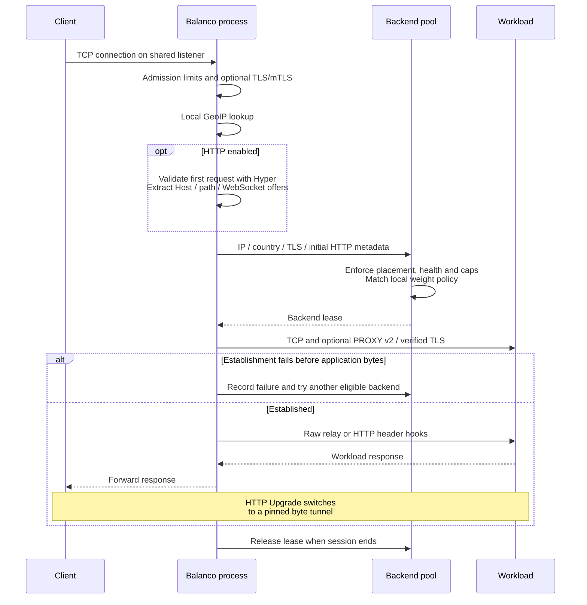
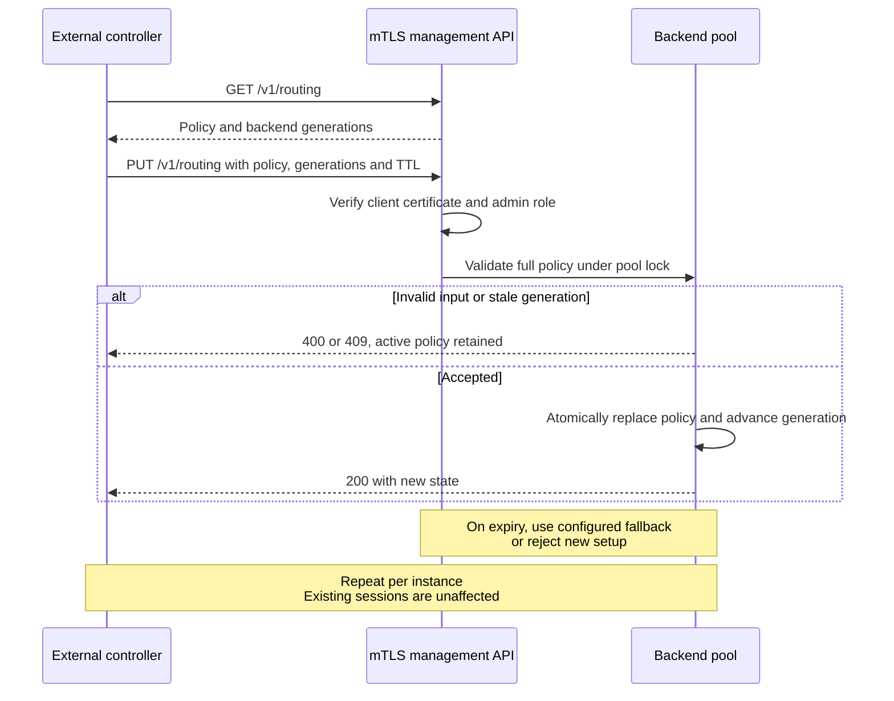

# Deployment and UML

These diagrams describe the implemented TCP/TLS proxy, metadata routing and decision-ingestion API. Weighted rendezvous affinity and TIPC transport remain planned additions.

## Deployment: shared data listener, independent management

The kernel chooses a process before TLS/HTTP parsing. Replicas sharing the data port must accept compatible clients and protocols. Management ports and Unix paths are unique; policies, health, limits and counters are independent. Fleet-wide updates require the controller to address each API. External inference does not run on connection acceptance.

## UML: core classes and ownership

`SchedulerState` represents `scheduler::State`; `RoutingState` represents `decision::State`; `HttpState` represents `http1::State`. Dropping a lease releases backend capacity on success, errors or cancellation. Scheduler locks never span network I/O.

## UML: connection establishment

HTTP header hooks currently run after backend selection; they do not choose another backend per request. Established TCP/WebSocket sessions keep their backend across policy changes.

## UML: external decision publication

